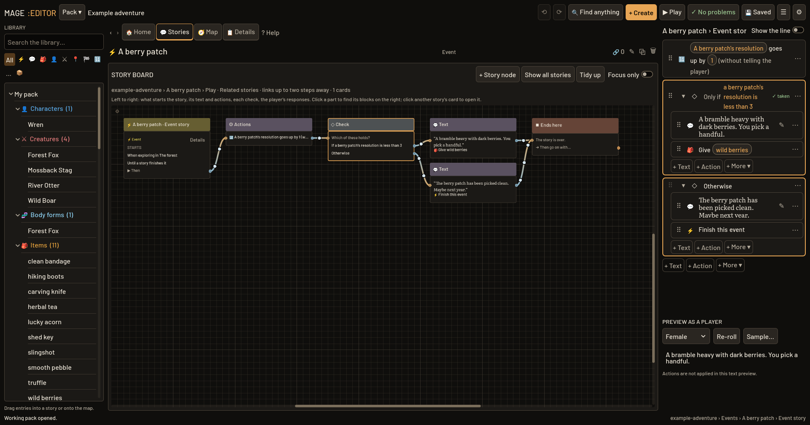
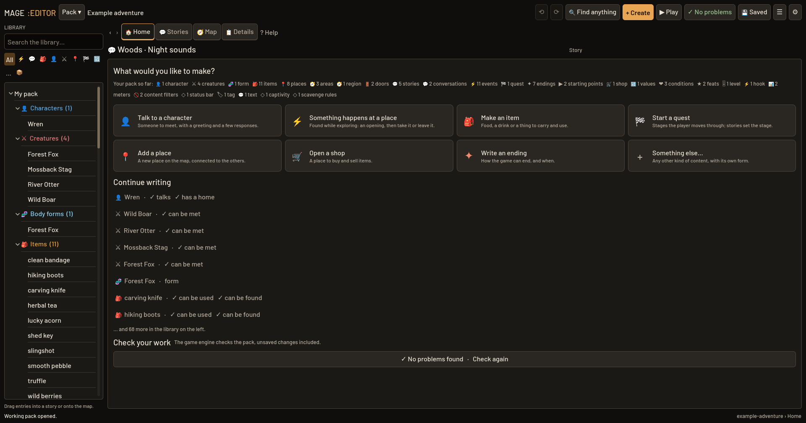
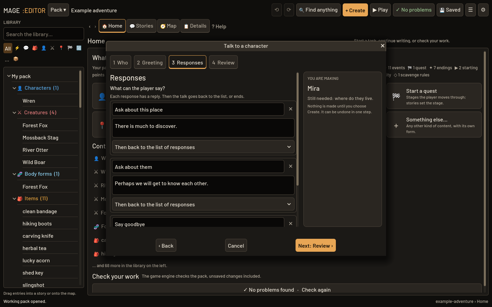
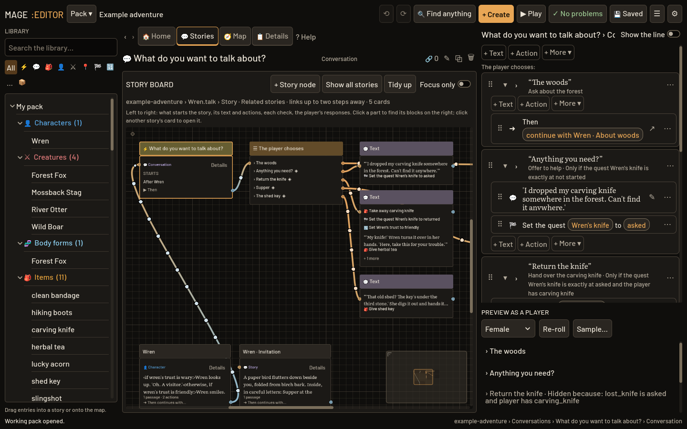
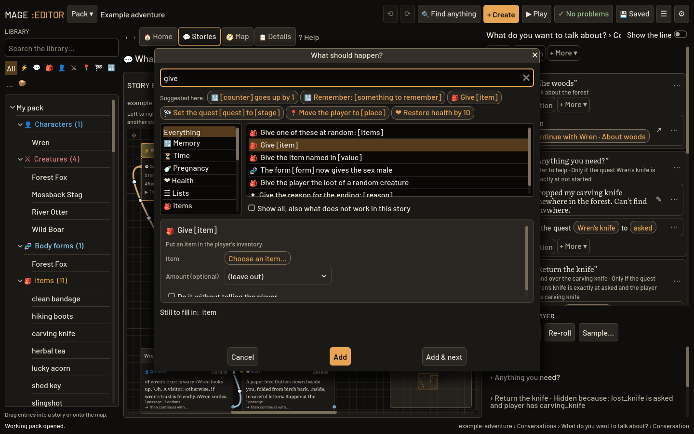
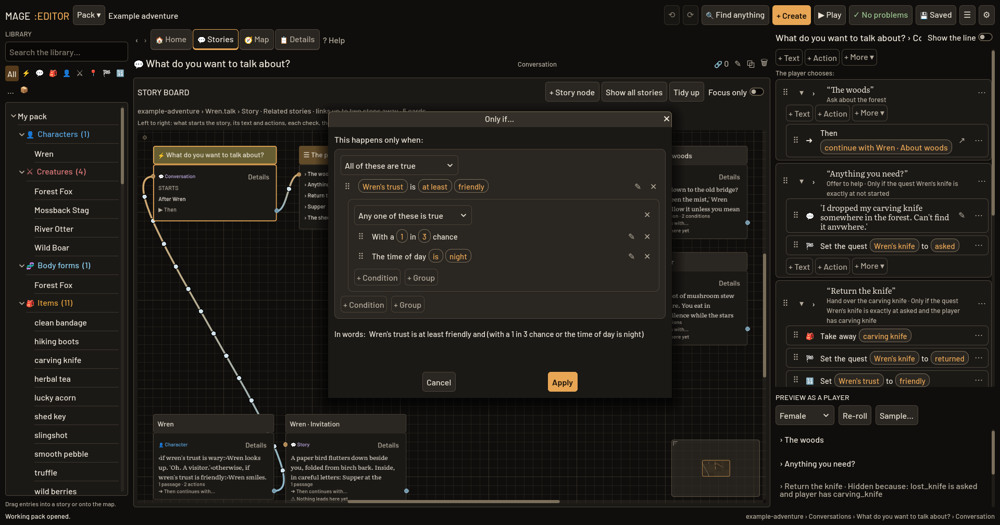
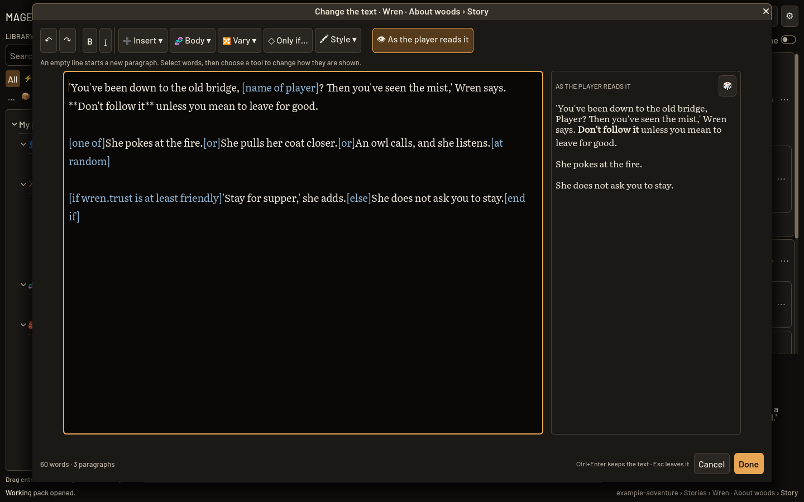
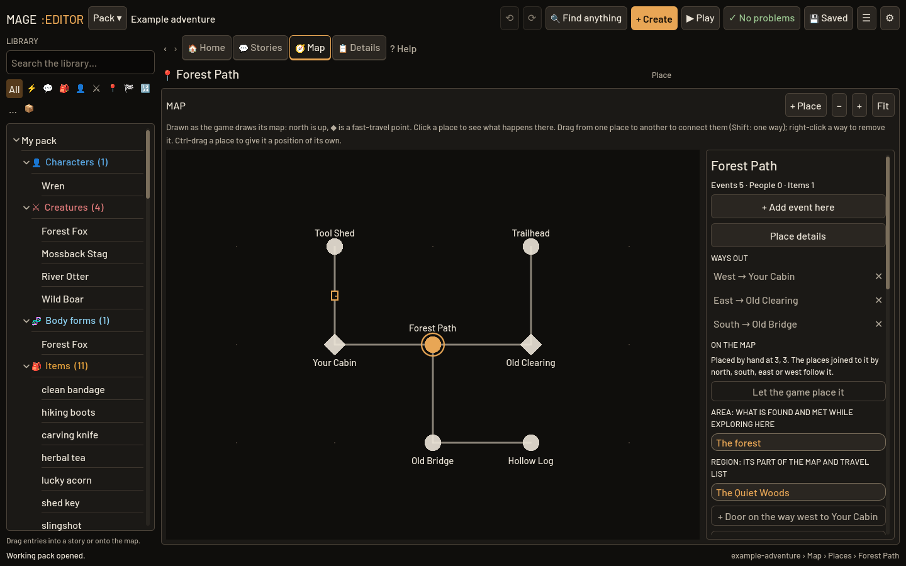
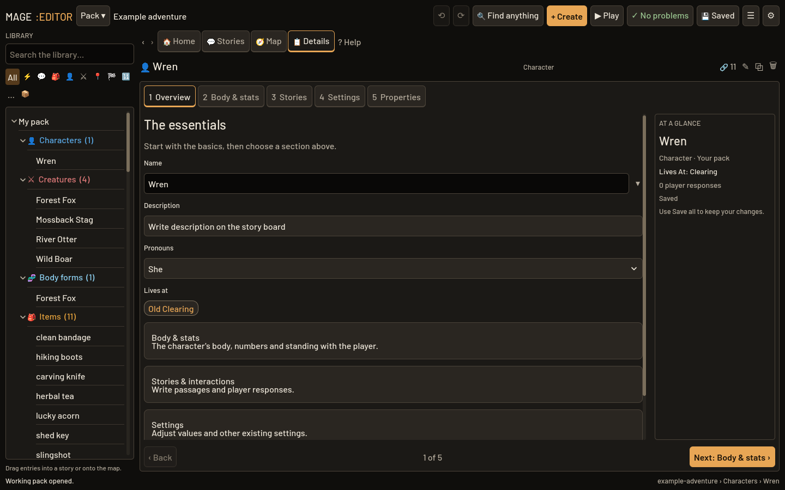
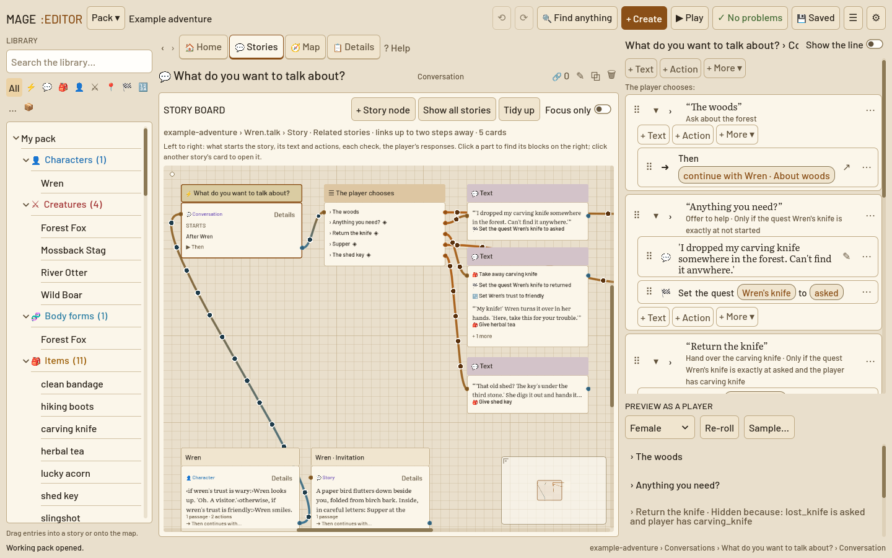

# MAGE:EDITOR

A desktop editor for making content packs for [MAGE](https://github.com/Seaturtle5/MAGE), the Modular Adventure Game Engine, without learning its content format. You write stories, build what happens from plain sentences, draw the map and try the result in the real game. The editor writes ordinary pack files and checks them with the game engine itself.



**It is in development.** Every kind of content the engine runs can be made and changed here, and it has been tried on a game of sixty packs, but few authors have used it yet and there is no installer. What is still missing is listed under [Not finished](#not-finished).

## Contents

- [What it does](#what-it-does)
- [Getting started](#getting-started)
- [The window](#the-window)
- [The board](#the-board)
- [Stories as blocks](#stories-as-blocks)
- [The map](#the-map)
- [Trying it in the game](#trying-it-in-the-game)
- [Working beside other packs](#working-beside-other-packs)
- [Finding and changing across the pack](#finding-and-changing-across-the-pack)
- [Safety](#safety)
- [Keys](#keys)
- [Not finished](#not-finished)
- [For developers](#for-developers)
- [License](#license)

## What it does

### Start from a task, not from an empty file

Home offers the things an author wants to make: talk to a character, something happens at a place, make an item, start a quest, add a place, open a shop, write an ending. A task asks a few questions page by page, shows what it will make, and creates everything connected, as one step you can undo.





### See a story as a flow

The story you open is drawn from left to right: a card that says what starts it, then a node for each run of text and actions, a **Check** for each "only if" with a way out for every answer, **The player chooses** with a line for each response, fights, and where it ends. Bubbles float along the lines the way they lead. The stories around it are cards; click one to open it.



### Build what happens from sentences

Every action is a sentence with the changeable parts as chips. **What should happen?** finds actions by everyday words (heal, trust, give), and you fill in the sentence by choosing from lists. There is a sentence for every action and condition the engine knows.



Conditions are built the same way, in groups: all of these, any of these, none of these. The condition is read back to you in words.



### Write in a large window

Text is written in a window that fills the editor. Its toolbar covers what the game understands inside text: bold and italic, names and "he or she" that follow the character, words about the player's body, several versions the game chooses between, words shown only under a condition. Beside your writing the same text is shown as a sample player reads it, and the editor says so when the game cannot read something.



### Draw the map as the game draws it

The map uses the game's own layout, one part of the world at a time, so a place is where the player will see it. Click a place to see what happens there and where its ways lead. Drag from one place to another to connect them, with or without a door.



### Change everything about a piece of content

Details has a page for every kind of content: characters, creatures, items, places, events, quests, shops, endings and the game's rules. Other content is chosen by name, numbers have number boxes, conditions are read in words.



### And also

- **Try it in the game.** One click starts the real game on your pack as it is now, unsaved changes included, with its own saves.
- **Work beside other packs.** The packs your pack uses load by themselves; their content can be used but never changed.
- **Change safely.** Every change is a named undo step. Renaming shows every line it will touch; deleting shows what uses the content.
- **Two themes**, dark and light, and an interface size from 90 to 150 %.



## Getting started

You need:

- [Godot 4.7](https://godotengine.org/download)
- Python 3
- a checkout of [MAGE](https://github.com/Seaturtle5/MAGE), on its current `main` branch (the editor uses the engine's own reader and checker, and needs a version newer than 1.0.0)

Then, in this folder:

```sh
./run.sh --engine /path/to/MAGE
```

`--engine` points to the MAGE checkout (the folder that contains `engine/`). You can set `MAGE_ENGINE` instead; the launcher also looks for an engine folder beside this one. To use another Godot program, set `GODOT` or pass `--godot /path/to/godot`.

The first launch opens a working copy of the engine's example adventure, so you can look around and change things freely. To work on your own pack, choose **Pack → Open pack…** and pick its folder, or **Pack → New pack…**.

The editor does not change the engine checkout. It keeps its preferences, recovery drafts and the saves of test plays in its own folder.

## The window

| Where | What |
|---|---|
| Top bar | **Pack** (new, open, add another pack, import a picture), **Undo / Redo**, **Find anything**, **Create**, **Play**, the check result, and **Save**. The gear holds the theme, the interface size and Reduce motion. |
| Library (left) | Everything in your pack by kind, and the other loaded packs folded away. Choose an entry to open it, or drag it into a story, onto the map or onto a matching picker. |
| Home | Guided tasks, what you worked on with hints about what it still needs, and problems. |
| Stories | The board: the opened story as a flow, the stories around it as cards. |
| Map | The map as the game draws it, with the overview of the chosen place. |
| Details | Everything about the selected content. The small buttons beside its name show where it is used, rename it everywhere, duplicate it and delete it. |
| Side editor (right) | The selected story as blocks, with a preview underneath. |
| Status line | What just happened, with **Undo**, and where you are. |

**‹ ›** beside Home go back and forward through what you looked at. The **☰** button opens the lists of saved values and problems: choose a value to see every story that changes it and every story that reads it.

## The board

Opening a story (from the library, from Home, from another story's card) draws it on the board:

| Node | What it shows |
|---|---|
| ⚡ The story's own card | What starts it: an event's trigger, condition and how often it happens; "When the player talks to Wren" for a story inside other content; the stories that lead to it; or a warning that nothing leads there yet. **Details** opens its settings. |
| 💬 Text, ⚙ Actions | A run of text and actions in order: the first lines, and how many more there are. |
| ◇ Check | An "only if": one way out for each condition, and one for when none holds. |
| ☰ The player chooses | The responses, each with its own way out. A ◈ marks a response that is only offered under a condition. |
| ⚔ Fight | The creature, and a way out for each result that has its own part. |
| ⏹ Ends here, ↩ Goes back | Where the story stops. From **Then go on with…** it can be sent on to another story. |

- Click a node and the blocks it stands for are outlined in the side editor, with the same outline as the node, and brought into view; there they are changed. It works the other way too: choose a block and its node is outlined.
- Bubbles float along every line the way it leads. With **Reduce motion** in the settings the lines carry arrowheads instead.
- Orange dots are ways you can lead elsewhere: drag one to another story's card (a response, the ending, a played story). Right-click a line to remove the link. Blue lines follow from the blocks themselves.
- A very long story draws its first sixty parts and says how many blocks are further in.
- **Show all stories** shows every story as a card, without a flow. **Tidy up** arranges the board again.

## Stories as blocks

Each block in the side editor is a sentence. The highlighted parts are chips: choose one to change it, or drop a library entry on it.

| To | Do |
|---|---|
| Add | **+ Text**, **+ Action** or **+ More** at the place you want it. Action opens "What should happen?": search with everyday words, fill in the sentence, **Add** or **Add & next**. You can also type a line you know. |
| Write | Double-click a text block, or choose **+ Text**, to open the writing window. Its toolbar has undo, **B**old and *I*talic, **Insert** (a name, he or she, a counter's number, a text kept for reuse), **Body** (words about the player's body), **Vary** (several versions, and how the game goes through them), **Only if…** and **Style** (a roll, a warning). Select words first to change those words. Long text fields on the Details page open the same window from **⤢ Write in a large window**. |
| Make it conditional | **⋯ → Only if…** puts the block (or all selected blocks) inside a condition. Add **Otherwise, if…** and **Otherwise** from the condition's own menu. |
| Move | Drag the handle; hold Ctrl to copy. Or use **⋯ → Move up / Move down**, or cut and paste. Shift-click and Ctrl-click select several blocks. |
| Copy between stories | Copy and paste work as lines of the content format, also to and from a text editor. |
| Work something out | Where a block takes an amount, choose **a calculation** and put it together from chips: numbers, counters, the signs, brackets, a random span, the smaller or larger of two numbers, a square root, a list's size or one of its entries. |
| Understand | **⋯ → Explain** says what a block does. **Show the line** shows the content format's line under every block. |
| Preview | The strip under the blocks shows the text as a sample player reads it. Conditions are marked taken or skipped for that sample. Actions are not applied; the preview stops at responses, pauses, links and fights. |

Some actions only work in certain stories (a fight action, "keep the item"). They are hidden elsewhere; **Show all** lists them greyed out with the reason.

Lists of responses that belong to other content open the same way: what the player can do at a place, a character's own actions, a creature's attacks.

## The map

A place stands where the game's own layout puts it: north is up, places joined by compass ways stand beside each other, ways up, down, inside and outside step off to the side. A ◆ is a fast-travel point, a small door on a path is a door, an arrow is a way that only leads one way, and a short dashed stub is a way that leaves this part of the map. Your own places are bright; places of other packs are outlined.

| To | Do |
|---|---|
| See another part of the world | Choose it in the list beside **MAP**: the game shows one region at a time, or the places of an area that belong to no region. |
| See what happens at a place | Click it: its events, people and items, its ways out, its area and region are listed on the right. Double-click opens its details. |
| Connect two places | Drag from one to the other. The direction offered is the one the second place lies in; choose a door if the way goes through one. Hold Shift for a way that only leads one way. |
| Remove a way | Right-click its path, or use the ✕ beside it in the place's list of ways out. |
| Put a place somewhere of your own choosing | Hold Ctrl and drag it. The game then keeps it there, and the places joined to it by compass ways follow. **Let the game place it** on the right gives the position back. |
| Move around | Drag the background, turn the mouse wheel, or use **−**, **+** and **Fit**. The arrow keys go from place to place. |

## Trying it in the game

**▶ Play** in the top bar starts the real game on your pack as it is now, unsaved changes included, in its own window: from a starting point of the game, at the selected place, or straight into the story you are working on (**▶ Try it** above the blocks does the same). The story plays for the sample player chosen in the preview. The game uses its own saves and settings for this; your own saves and the other packs are not touched. A pack with problems is not started; the first problem is shown instead.

The game is taken from the engine checkout the editor was started with.

## Working beside other packs

A pack rarely stands alone: it uses the base pack's items, another author's places. When you open a pack, the editor looks in the folder it sits in and loads the packs that belong with it: the packs it needs, the packs that need it, and the other packs that need the same base pack. With a whole game this can be sixty packs.

- Your own pack opens at once. The others are read behind the scenes, and the check mark in the top bar says **Loading packs…** until they are in. You can already write.
- The other packs cannot be changed here. Using something of theirs adds the pack to the ones yours needs.
- After every change the editor checks the changed file at once, and then checks your whole pack against the others behind the scenes; problems appear on their blocks when it is done, usually within a second or two.
- **Check** in the top bar checks every loaded pack's stories again. With a whole game loaded this takes a quarter of a minute; you can keep working meanwhile.

Without the packs it uses, a pack shows a problem for everything it takes from them. If your packs are not kept side by side, add them with **Pack → Add another pack**.

**A pack of pictures.** A pack can hold pictures for other packs' content. On the pack's own page, **Art** says how they count: **Replaces** puts them in place of the content's own pictures, **Fallback** only fills gaps. Import the pictures (**Pack → Import a picture**), open the other pack's character, place, creature or item from the library, and choose the small **🖼** beside its name: your pack then adds the picture to that content, and the other pack's files stay as they are.

## Finding and changing across the pack

| To | Use |
|---|---|
| Jump anywhere | **Find anything**: content by name, your own stories by their text, values and commands. |
| Change a word in the story text | **Pack → Find and replace in story text**. Only the words players read are searched; every line is listed before anything changes. |
| See what moves a quest | Open the quest and choose **What moves it?**: each stage with the stories that set it, and a button to set it from another story. |
| See how packs depend on each other | **Pack → How the packs depend on each other**. |
| Go back in time | **Pack → History of changes** lists every change; choose one to go back to just after it. |

## Safety

- Every change is one step in Undo, named after what it did. Save is separate and explicit.
- Unsaved changes are copied to a recovery draft every 30 seconds and offered after a crash.
- **Rename** lists every line that will change before anything changes. Story text is not touched; a rename that would break something is taken back.
- **Delete** shows what uses the content and can remove the actions and links that use it.
- Saving stops if a file changed on disk since it was opened. Other packs are never changed.
- Content the editor cannot show as a control is kept exactly as it is in the file.

## Keys

| Key | Does |
|---|---|
| Ctrl+K | Find anything |
| Ctrl+S | Save all |
| Ctrl+Z, Ctrl+Shift+Z or Ctrl+Y | Undo, redo |
| Ctrl+H | Find and replace in story text |
| Alt+←, Alt+→ | Back and forward through what you looked at |
| Enter on a text block | Write it |
| Ctrl+Enter, Esc in the writing window | Keep the text, leave it |
| Ctrl+B, Ctrl+I in the writing window | Bold, italic |
| Alt+↑, Alt+↓ on a block | Move it up or down |
| ←, → on a block with parts | Fold it, unfold it |
| Shift+F10 or the Menu key on a block | Its menu |
| Ctrl+C, Ctrl+X, Ctrl+V, Delete on a block | Copy, cut, paste below, remove |
| Arrow keys on the map, Enter | Go from place to place, open the place |

Every drag has a menu or a key that does the same.

## Not finished

- There is no installer: the editor is started from a checkout with Godot and Python, as described above. It has been run on Linux only.
- A few number fields of the game's rules take a calculation as a short typed formula, and the roles and change texts of saved values cannot be changed.
- In the writing window, variations and conditional words are written as marked text, not as panels; there is no spell check.
- The map does not set a region's travel order or map grid; a door that leads into an area is set in the door's details. Exits that stories make in play are placed by the game's layout but not drawn as paths.
- The board draws the flow of one story at a time; a part of the flow is changed in the side editor, not on the board.
- Playing in the game does not lead back to the block that was played, and the sample player's body form is not passed on.
- With very many packs loaded (several thousand pieces of content), the preview under the blocks updates when you ask. A check of your own pack does not look again at the other packs' stories: a problem your change causes in another pack's story shows after **Check**.
- A board of every story of a large game is not drawn: beyond 150 cards the board shows the first ones and says how many are left out.

## For developers

The editor is a Godot 4.7 project in statically typed GDScript. `launch.py` stages it in a temporary project together with the content library of the MAGE checkout it is given, so it reads, compiles and checks content with the engine's own code and has no second grammar of its own. It changes pack files as text, within the exact lines an operation is about, so comments, attribution and anything unfamiliar stay as written.

`AGENTS.md` describes the rules the code follows, what each file in `src/` does, how the editor stays fast with a whole game loaded, and how the two themes are built.

## License

MAGE:EDITOR is licensed under [CC BY-NC-ND 4.0](https://creativecommons.org/licenses/by-nc-nd/4.0/), like MAGE itself. You may copy and share it unchanged, for non-commercial purposes, as long as you credit it. Selling it or sharing modified versions requires permission. Packs you make with it are your own work and belong to you. See [LICENSE](LICENSE) for the full terms.
